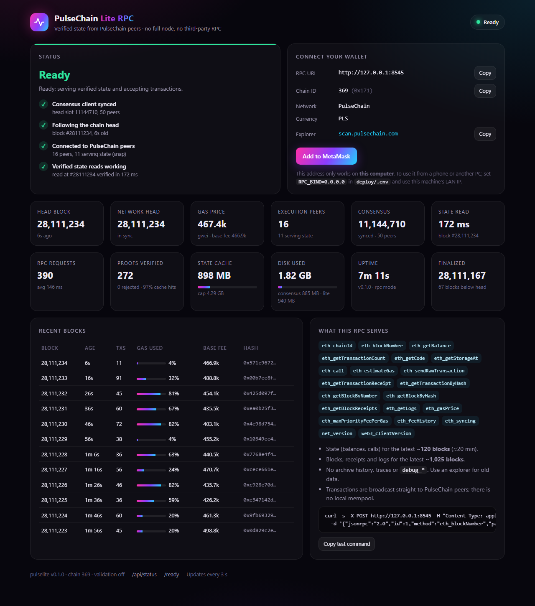

# Disclaimer

> **Beta software.** PulseChain Lite RPC has been tested extensively, with
> automated tests, side-by-side comparisons against a full node, and
> multi-hour runs, but it hasn't been independently security-audited. It is
> provided "as is", without warranty of any kind. By running it, you accept
> full responsibility for its use and for any transactions you send through
> it; the authors aren't liable for any loss or damage.

# Support Open Source Software
Please consider supporting development of open-source software and consider donating to this railway privacy address.
Follow me on [Twitter/X](https://x.com/DevJuyoung)

PulseChain/Ethereum Address:
0xa6da547D2E3673F87CE77165e0163AE45684E244

Railway:
0zk1qy2c4ts36sx37g2rtmwlveh2zl7tc7f4j8fcqatd24uevzgsazjqhrv7j6fe3z53llemn5cztc6rh0kn52qztmajfvnpaj22jmhmlpl0ph22ysm07xtwyky9gsq

Skip ahead to the "Quick Start" section for instructions.

Only requirement is that Docker Desktop is installed (Windows/MacOS)
Untested on MacOS & Linux. Feedback welcome.

## Troubleshooting 
-> If you use setup.cmd or the deploy script and it gets stuck, just close and retry.

-> If Docker closes, just restart it.

-> If Docker issues persist, delete the container and rerun setup for fresh, working install.

Note: Can take up to a minute or so to come online depending on your connection.

# PulseChain Lite RPC

Your own PulseChain JSON-RPC endpoint in a few GB of disk, **without a full
node and without any third-party RPC provider**. Point MetaMask (or any
wallet/dapp/script) at it and it answers balances, contract calls, gas
estimates, receipts and recent logs, and broadcasts your transactions.

It runs next to an **official, unmodified** PulseChain consensus client
(lighthouse-pulse; checkpoint sync, JWT Engine API) and gets all execution
data from the **PulseChain devp2p network**, using the same `eth/68` and `snap/1`
protocols go-pulse nodes use to sync each other:

* **No full state on disk.** The accounts, storage slots and contract code a
  request touches are fetched from ordinary go-pulse peers and **verified
  with Merkle proofs** against the state root the consensus client delivers
  (go-pulse's own `trie.VerifyProof`/trie code). A peer cannot feed you a
  wrong balance. Verified data is kept in a **bounded cache** (1 GiB by default in RPC mode).
* **No event-log history.** Only a recent block window is kept (headers 8192,
  bodies/receipts/logs ~1024 blocks).
* **Validation is off in this release.** The consensus client follows the
  chain optimistically; block execution for validators exists in the code
  but is disabled (see *Experimental validator modes*).



```
 wallets / dapps ──► pulselite JSON-RPC + dashboard :8545
                            │
 lighthouse-pulse ──Engine API + JWT──► pulselite ── head, state roots (trusted: consensus)
 (checkpoint sync)          │
             verified partial state (trie.VerifyProof, hash links)
                            │                                   ▲
             bounded cache + recent block window                │ snap/1: range proofs, trie nodes, code
                                                                │ eth/68: headers, bodies, receipts,
                                         PulseChain devp2p peers   tx broadcast
```

## At a glance

PulseChain Lite RPC is a **personal, private RPC** for people who want to
check balances and send transactions through their own node, without the
hundreds of GB a full node needs and without trusting a public RPC provider.
It doesn't store the chain's state. It fetches just the pieces each request
needs from ordinary PulseChain nodes and checks them cryptographically
against the chain's state root, so peers can't feed it false data. It
**isn't a replacement for a full-node RPC** and isn't meant for businesses,
public endpoints or services with many users. It has no archive history,
cold reads are slower than a local full node, and it depends on the
PulseChain peer network being available.

| | |
|---|---|
| **What it is** | A private RPC for one person's wallet and dapp use: balances, contract calls, gas estimates, recent receipts and logs, and sending transactions |
| **What it isn't** | A full node, an archive node, a public or shared RPC, infrastructure for businesses, indexers, explorers or bots, or a validator (validator modes are experimental and off) |
| **What it relies on** | Docker; the official lighthouse-pulse consensus client; PulseChain's checkpoint server (`checkpoint.pulsechain.com`) at each start; ordinary go-pulse peers on the PulseChain p2p network for state, blocks and transaction broadcast |
| **Strengths** | ~0.25 GB of chain data at start and ~4 GB at most (vs hundreds of GB); ready ~40 s after start, even after days offline; no third-party RPC sees your queries or transactions before they're public; every balance and call result is Merkle-proof verified; private by default (only reachable from your computer) |
| **Weaknesses** | State only for the latest ~120 blocks and logs/receipts for ~1,000 blocks (no history, traces or `debug_*`); cold reads take ~150–500 ms instead of a few ms; depends on peers that serve state; trusts consensus (validator signatures plus the checkpoint server) without re-executing blocks; no local mempool or rebroadcast; doesn't protect against sandwiching (transactions go to the public mempool); new, unaudited software |

## Quick start

Requirements: Docker (Docker Desktop on Windows/macOS) with Compose v2,
**~8 GB free disk** (see *Disk space*), 4 GB+ RAM, and the `pulselite/` and `deploy/` folders of
this repository. The image builds from source, using only
`pulselite/vendor/` for Go dependencies; no Go modules are downloaded (see
*Go dependencies*).

**1. Start Docker first.** Open Docker Desktop (Windows/macOS) and wait
until it shows **Engine running**. On Linux, make sure the Docker service is
running (`sudo systemctl start docker`). If Docker Desktop is installed but
not running, the setup scripts try to start it and wait up to 3 minutes;
if that fails, they stop with "Unable to start Docker. Please start Docker
Desktop ... and try again."

**2. Run setup.**

**Windows:** double-click `deploy\setup.cmd` (or run it from a command
prompt). It starts `scripts\setup.ps1` without tripping PowerShell's
"running scripts is disabled" policy, and doesn't change any system setting.
Running `.\scripts\setup.ps1` directly also works if your policy allows it,
and so does `./scripts/setup.sh` in Git Bash.

**Linux/macOS:**

```bash
cd deploy
./scripts/setup.sh
```

If that doesn't work, try adding bash

```bash
cd deploy
bash scripts/setup.sh
```

The script writes the settings into `deploy/.env`, runs
`docker compose up -d --build`, and **waits until the node reports ready**:

```
Dashboard + RPC: http://127.0.0.1:8545  (open it in a browser)
Waiting for the node to become ready ...
  [21:31:01] Starting: waiting for the consensus client.
READY: serving verified state and accepting transactions.
Wallet settings: RPC URL http://127.0.0.1:8545 | Chain ID 369 | Symbol PLS | Explorer https://scan.pulsechain.com
```

Options: `-Lan` / `--lan` (reachable from phones and other PCs on your
network), `-Proxy` / `--proxy` (single endpoint on :8080 that also exposes
the Beacon API), `-NoWait` / `--no-wait`.

For more peers, open/forward **TCP+UDP 30303** (execution p2p) and
**TCP+UDP 13000** (consensus p2p) on your router. It works without this,
with fewer peers.

### Troubleshooting the first start

* **"Docker is not running" / "Unable to start Docker"**: open Docker
  Desktop, wait for **Engine running** (the first start after a reboot can
  take a minute or two), then run setup again. "Docker is not installed"
  means the `docker` command wasn't found: install Docker Desktop and
  reopen your terminal.
* **"running scripts is disabled on this system"** (PowerShell): use
  `setup.cmd`, or run
  `powershell -ExecutionPolicy Bypass -File .\scripts\setup.ps1`.
  If the repository was downloaded as a ZIP, `Get-ChildItem -Recurse | Unblock-File`
  in the repository folder also clears Windows' "downloaded from the
  internet" flag.
* **`go mod download` ... "checksum mismatch ... SECURITY ERROR"**: this
  came from older versions that downloaded Go modules during the build
  (a hash of `h1:G7mAYYxgmS0lVkHyy2hEOLQCFB0DlQFTMLWggykrydY=` means a file
  arrived empty, usually a corrupt Docker build cache). The build now uses
  the vendored dependencies, so update to the current files (including
  `pulselite/vendor/`) and rerun setup. `docker builder prune -af` clears
  any old build cache.
* **"inconsistent vendoring"**: `go.mod` was changed without refreshing
  `vendor/`; see *Go dependencies*.
* **Docker base images** (`golang`, `debian`, lighthouse) are downloaded
  from Docker Hub/GitLab once per machine, then reused from Docker's local
  image store.

### Go dependencies

Every Go dependency, including the go-pulse packages pulselite uses, is
checked into `pulselite/vendor/` (~61 MB, 79 modules). The Docker build sets
`GOFLAGS=-mod=vendor GOPROXY=off`, so it compiles only from that folder and
fails rather than fetching anything. Builds work offline and can't receive
a substituted dependency. The vendored code is the code under review, so
changes to it show up in diffs like any other source.

To change dependencies (or after pulling a newer `go-pulse/` next to this
repository), refresh the folder on a machine with network access and commit
the result:

```bash
cd pulselite
go mod tidy && go mod vendor && go mod verify   # verify checks every module against go.sum
```

or without a local Go install:

```bash
docker run --rm -v "$PWD/..:/src" -w /src/pulselite golang:1.24-bookworm sh -c "go mod vendor && go mod verify"
```

## How to know it is ready

Open **http://127.0.0.1:8545** in a browser. The dashboard shows a status
badge (**Ready** / Syncing / Starting / Not working) and four checks. Each
check shows a green ✓ when done, a **spinner** while it is still working
(starting up, syncing, connecting to peers, retrying a read), and a red ✕
only when something has stopped working: the consensus client unreachable
5 minutes after startup, no new blocks for 5 minutes although it is synced,
no peers 5 minutes after startup, or state reads failing for 2 minutes.
The node is ready (serving verified state and accepting transactions) when
all four are green:

| Check | Passes when |
|---|---|
| Consensus client synced | lighthouse is reachable and at most 2 slots behind the wall clock (its head is reported "optimistic", which is expected with validation off) |
| Following the chain head | the newest block is less than 90 s old and at most 3 blocks behind the network |
| Connected to PulseChain peers | at least one execution peer, and one serving state (snap) |
| Verified state reads working | a Merkle-verified state read at (or within 6 blocks of) the newest block succeeded |

It also shows head/network block, gas price, peers, state-read latency, RPC
request count and latency, proofs verified, cache and disk usage, and the
latest blocks.

For scripts and monitoring:

* `GET http://127.0.0.1:8545/ready` returns **200** when ready and **503**
  otherwise, with the failing checks in the JSON body.
* `GET /api/status` returns the full dashboard data as JSON.
* `eth_syncing` returns `false` once the head is within 3 blocks of the
  network, and a `{currentBlock, highestBlock}` object while catching up.

**Start time:** every start (first or later) checkpoint-syncs lighthouse to
the current finalized block; in testing the node was **ready 42 s** after
`docker compose up`. See *Disk space* for why every start is a fresh
checkpoint.

## Disk space (RPC mode)

| Part | At a fresh start | Maximum | What bounds it |
|---|---|---|---|
| Consensus database (lighthouse) | ~0.15 GB | ~2.0 GB | `LH_DB_BUDGET_MB=2000`: past it, lighthouse restarts from a fresh checkpoint (~40 s without RPC) |
| Verified state cache | grows with use | ~1.1–1.6 GB on disk | `CACHE_MAX_BYTES` (rpc default 1 GiB, two generations evicted wholesale) |
| Recent blocks, receipts, peers | ~0.1 GB | ~0.1 GB | fixed windows (8192 headers, 1024 blocks) |
| **Chain data total** | **~0.25 GB** | **~3.5–4 GB** | hard stop at `TOTAL_DISK_LIMIT` (rpc default 8 GB); the execution folder alone is capped at 3 GiB |
| Docker images + build cache | ~2.5 GB | ~2.5 GB | lighthouse 0.4 GB + pulselite 0.2 GB + Go build image 1.3 GB and its cache (`docker builder prune -af` and `docker image rm golang:1.24-bookworm` free ~1.5–2 GB after the first build) |

**Restarts:** in RPC mode lighthouse starts from a **fresh checkpoint sync
every time** (`LH_FRESH_START=true`): it downloads the current finalized
state (~18 MB) from `checkpoint.pulsechain.com` and is ready in ~40 s, no
matter how long the node was off. That way no consensus history accumulates
between sessions, and there's no long catch-up after days offline. The lite
node keeps its cache and block window across restarts.

Without these settings, lighthouse back-fills ~17 weeks of beacon blocks
(~5 GB, ~210 MB/hour at ~12 slots/s) and then grows ~60 MB/day forever
(every new block plus an ~18 MB state snapshot per ~23 h). That's fine for
validators, which is why the experimental validator modes turn both
settings off (`LH_FRESH_START=false`, `LH_DB_BUDGET_MB=0`).

Smaller footprint: `LH_DB_BUDGET_MB=1000` (re-checkpoints about every 4 h of
uptime instead of every ~9 h) and `CACHE_MAX_BYTES=512MiB` keep chain data
under ~2 GB. Lighthouse's own debug log files are disabled
(`--logfile-max-number=0`), and Docker keeps at most 3 × 10 MB of console
logs per container.

## Point your wallet or dapp at it

**MetaMask (or Rabby, etc.):** click **Add to MetaMask** on the dashboard,
or add the network manually:

| Field | Value |
|---|---|
| Network name | PulseChain (Lite RPC) |
| RPC URL | `http://127.0.0.1:8545` |
| Chain ID | `369` |
| Currency symbol | `PLS` |
| Block explorer | `https://scan.pulsechain.com` |

Then select that network. Dapps that use your wallet's connection (the usual
"Connect wallet" flow: swaps, staking, token pages) automatically read
through and send transactions via your node. Some dapps also read through
their own RPC; those reads aren't affected.

**Other devices:** `127.0.0.1` only works on the computer running the node.
Run setup with `-Lan` / `--lan` (or set `RPC_BIND=0.0.0.0` in `deploy/.env`
and `docker compose up -d`), then use `http://<this computer's LAN IP>:8545`.
Don't forward port 8545 to the internet: the endpoint has no authentication.

**Developers:** it's a standard JSON-RPC endpoint, e.g.
`new ethers.JsonRpcProvider("http://127.0.0.1:8545")` or
`createPublicClient({ transport: http("http://127.0.0.1:8545") })`.
Batch requests are supported (up to 100 per batch).

## Sending transactions

`eth_sendRawTransaction` checks the signed transaction against verified
state (chain ID, nonce not already used, enough balance for gas + value),
then **broadcasts it directly to the connected PulseChain peers**, the same
way a full node propagates transactions. It returns the hash immediately. Once a
validator includes it, `eth_getTransactionReceipt` returns the receipt
(usually within one or two 10 s blocks). There's no local mempool: pending
transactions aren't visible through this node, and wallets track their own
pending nonces as usual.

## What it cannot do

* State (balances, `eth_call`) only for the **latest ~120 blocks**
  (≈ 20 minutes), because that's what snap peers serve.
* Blocks/receipts/logs only for the latest **~1024 blocks**; there's no
  archive, `debug_*`/`trace_*`, `eth_getProof`, filters/subscriptions or
  txpool. Use an explorer for history. Out-of-window requests fail fast with
  a clear `not available` error.
* Cold reads cost a network round trip (~150–500 ms); cached reads take a few ms.

## Managing the stack

Run from `deploy/`:

| Task | Command |
|---|---|
| Status of containers | `docker compose ps` |
| Logs | `docker compose logs -f execution` / `docker compose logs -f lighthouse` |
| Stop (data kept) | `docker compose down` |
| Start again | `docker compose up -d` (or rerun the setup script) |
| Update after pulling new code | rerun the setup script (rebuilds the image) |
| Erase all data | `docker compose down -v` |

Data lives in the Docker named volume `pulselite-data` (`DATA_DIR` in
`.env`). On Linux you can use a host path such as `./data` instead; on
Docker Desktop keep the named volume, because bind mounts are very slow for databases.

| Endpoint | Address |
|---|---|
| JSON-RPC + dashboard + `/ready` + `/api/status` | `http://127.0.0.1:8545` |
| Single endpoint (RPC at `/`, Beacon API at `/eth/...`) | `http://127.0.0.1:8080` (`-Proxy`) |
| Beacon API | `http://127.0.0.1:3500` |
| Metrics (Prometheus) / health / ready | `http://127.0.0.1:6060/metrics`, `/health`, `/ready` |

### Consensus client choice

`COMPOSE_PROFILES` in `.env` selects `lighthouse` (default) or `prysm`.
**prysm-pulse v2.3.0 (the latest release) currently cannot import new blocks
from PulseChain peers**: it reads the 4-byte fork digest of p2p responses
with a single `stream.Read`, which can return only 3 bytes, and then rejects
every response as `saw digest=0x845ee500` (the real Capella digest is
`0x845ee52a`). It stays stuck at its last slot. lighthouse-pulse v2.5.1 is
not affected, which is why it is the default.

## Modes (`PULSELITE_MODE`, `-Mode` / first script argument)

| Mode | Executes every block | Validator duties | Public RPC |
|---|---|---|---|
| `rpc` (default) | no: consensus client runs optimistically | **no** | full |
| `validator` (experimental) | yes | yes (attest + propose) | status methods only (`eth_chainId`, `eth_blockNumber`, `eth_syncing`) |
| `full` (experimental) | yes | yes (attest + propose) | full |

In `rpc` mode lighthouse runs with `--disable-deposit-contract-sync`
(`LIGHTHOUSE_EXTRA_FLAGS` in `.env`) and pulselite doesn't scan the
deposit-contract history; neither is needed without validators.

## Experimental validator modes

**Disabled by default.** Block validation over p2p is correct (0 mismatches
in testing) but not yet fast enough: a block must be validated within ~3 s
for reliable attestations, and over p2p it takes ~6–60 s (see
*Limitations*). The code is kept for future work. To run it anyway:

```powershell
.\scripts\setup.ps1 -Mode full -ExperimentalValidator [-Validator]
```

This sets `PULSELITE_EXPERIMENTAL_VALIDATOR=true` and an empty
`LIGHTHOUSE_EXTRA_FLAGS` (so lighthouse syncs deposit logs again). Without
the flag, pulselite refuses to start in `validator`/`full` mode.

The consensus client does everything consensus-related; pulselite only
validates payloads and builds blocks.

1. Run in `full` or `validator` mode with the experimental flag.
2. Import keys with the lighthouse-pulse (or prysm-pulse) validator tooling
   into `<DATA_DIR>/validator/<client>`, set `FEE_RECIPIENT` in `.env`.
3. Start with `-Validator` (adds the `validator` profile).

* **Attesting** needs a non-optimistic head, i.e. pulselite must answer
  `VALID` in time. Check `curl 127.0.0.1:3500/eth/v1/node/syncing`
  (`"is_optimistic": false`). See *Limitations* for current p2p latency.
* **Proposing**: `engine_forkchoiceUpdated` with payload attributes builds a
  block with the **withdrawals only (no transactions)** on the validated
  head (no mempool), its state root computed from verified state. Valid,
  but earns no priority fees.
* **Deposits**: the deposit-contract history is rebuilt once from p2p data
  (see below) and served to the consensus client's `eth_getLogs`.

## Where every piece of data comes from

| Data | Source | Verification |
|---|---|---|
| State roots, block hashes, head/finalized | consensus client (Engine API, Beacon API) | trusted (consensus) |
| Accounts, storage | snap `GetAccountRange`/`GetStorageRanges` single-key range proofs, snap `GetTrieNodes` by path | `trie.VerifyProof` against the state root; trie nodes reachable only through hash links from the root |
| Contract code | snap `GetByteCodes` | keccak == code hash in the verified account |
| Headers | eth `GetBlockHeaders` | by hash, or parent-hash linkage to a consensus-trusted header |
| Bodies / receipts | eth `GetBlockBodies` / `GetReceipts` | transactions/withdrawals/uncles roots, receipts root |
| Deposit logs | headers (bloom filter) + receipts of matching blocks | header chain linked back from the finalized block; receipts root |
| Checkpoint state (consensus client) | `checkpoint.pulsechain.com`, once at first start | weak-subjectivity checkpoint (inherent to checkpoint sync) |

No RPC provider is contacted. `--upstream` can opt in to RPC endpoints
instead of p2p (same verification), but is empty by default.

## How block validation works (experimental modes)

1. **Discovery rounds**: the block is executed with go-pulse's state
   processor on a `state.Reader` backed by the partial trie. Every lookup
   that hits a missing trie node records *which* node (path + hash) it
   stopped at, and execution continues (pre-checks relaxed, since a round
   with misses is never accepted).
2. **Bulk fetch**: all missing nodes are requested with snap `GetTrieNodes`
   by path — including every deeper prefix of each key's path, so a whole
   missing branch arrives in one round trip — split across peers, with
   hedged requests (slow peers are raced by the next best peer). Contract
   code of newly resolved accounts is fetched in the same pass; cold
   accounts fall back to single-key range proofs.
3. Rounds repeat until one completes with **zero misses**; only that result
   counts. Branch-collapse siblings (needed when deleting keys) are fetched
   by path the same way.
4. State root, receipts root, gas used and bloom are compared with the
   payload → `VALID`; the post-state is committed into the cache, so the
   next block starts warm.

The service never reports `INVALID` for a block it merely could not process
(timeouts, unavailable peers): it answers `SYNCING` and the consensus client
imports optimistically. `INVALID` is only returned for malformed payloads.

## Supported RPC methods

| Method | Notes |
|---|---|
| `eth_chainId`, `net_version`, `net_listening`, `net_peerCount`, `web3_clientVersion`, `web3_sha3`, `eth_syncing`, `eth_blockNumber`, `eth_accounts`, `eth_mining`, `eth_hashrate` | |
| `eth_getBalance`, `eth_getTransactionCount`, `eth_getCode`, `eth_getStorageAt` | verified; `latest`/`safe`/`finalized`/number/hash within the state window (~120 blocks, what snap peers serve) |
| `eth_call`, `eth_estimateGas` | verified state; state/block overrides not supported |
| `eth_getBlockByNumber`, `eth_getBlockByHash`, `eth_getTransactionByHash`, … | headers for 8192 blocks, bodies for 1024 blocks |
| `eth_getTransactionReceipt`, `eth_getBlockReceipts`, `eth_getLogs` | 1024-block window only (no log history) |
| `eth_gasPrice`, `eth_maxPriorityFeePerGas`, `eth_feeHistory` | computed from the window |
| `eth_sendRawTransaction` | checked against verified nonce/balance, broadcast to devp2p peers |

Not supported: historical state beyond the window, archive/`debug_*`/`trace_*`,
`eth_getProof`, filters/subscriptions, pending state, txpool. Outside-window
requests fail fast with a clear `-32000 ... not available` error.

## Configuration

All flags have `PULSELITE_*` environment equivalents (see `deploy/.env`).

| Flag | Default | |
|---|---|---|
| `--mode` | `rpc` | `rpc` \| `validator` \| `full` |
| `--experimental.validator` | `false` | required for `validator` / `full` |
| `--rpc.port` / `--rpc.corsdomain` / `--rpc.vhosts` | 8545 / `*` / `*` | public RPC (host binding: `RPC_BIND` in `.env`) |
| `--p2p.port` / `--p2p.maxpeers` / `--p2p.nat` / `--p2p.bootnodes` | 30303 / 50 / any / PulseChain bootnodes | devp2p |
| `--upstream` | *(empty)* | opt-in RPC endpoints instead of p2p |
| `--logs.window` / `--headers.window` / `--blocks.window` | 1024 / 8192 / 128 | bodies+receipts / headers / side-chain retention |
| `--cache.max-bytes` / `--disk.limit` / `--disk.total-limit` | rpc: `1GiB` / `3GiB` / `8GB`; validator/full: `4GiB` / `10GiB` / `25GB` | cache cap; hard limits (execution / execution+consensus), exceeding them exits non-zero. Empty env values use the mode default |
| `--exec.deadline` | `7s` | experimental modes: max time `newPayload` waits before answering `SYNCING` |

## Metrics

`pulselite_p2p_peers`, `pulselite_p2p_snap_peers`,
`pulselite_p2p_requests_total{result}`, `pulselite_cache_*`,
`pulselite_proof_verifications_total{result}`,
`pulselite_code|header|receipt_verifications_total{result}`,
`pulselite_newpayload_total{status}`, `pulselite_exec_seconds`,
`pulselite_exec_rounds`, `pulselite_sibling_searches_total{result}`,
`pulselite_deposit_scan_progress`, `pulselite_deposit_logs`,
`pulselite_head_block`, `pulselite_validated_block`, `pulselite_reorgs_total`,
`pulselite_disk_bytes{component=execution|watched|total}`,
`pulselite_rpc_http_requests_total`, `pulselite_rpc_http_seconds`.

## Verification scripts

Run from `deploy/` while the stack is up (`.sh` and `.ps1` versions):

| Script | What it checks |
|---|---|
| `compare-rpc` | balances, nonces, code, storage (incl. mapping slots), `eth_call`, `eth_estimateGas`, logs, receipts at the same block against an independent reference node (test oracle only, default `https://rpc.pulsechain.com`); exits 1 on any mismatch |
| `measure-disk` | consensus + execution disk usage → `measurements.csv`; exits 1 above 25 GB |
| `bloat-test` | query load → restart cycles; fails if the cache exceeds its cap or the datadir grows unboundedly |
| `soak` | multi-hour disk + health + comparison loop; **resumable** (progress in `data/soak-state.json`, downtime not counted); `soak-autoresume.ps1` installs a logon task that resumes it after a reboot |

Unit/integration tests, offline from the vendor folder (`docker run --rm -v "$PWD/pulselite:/src" -w /src golang:1.24-bookworm go test ./...`):

* `internal/proof` — mainnet `eth_getProof` fixtures against a real state
  root; every tamper case (balance, nonce, code hash, storage root, values,
  swapped keys, wrong root, truncated/corrupted proofs, junk nodes).
* `internal/p2pnet` — a fake go-pulse snap peer built from a generated chain:
  whole chain validated from snap range proofs; collapse siblings via
  `GetTrieNodes`; warm-cache node-by-path fetching; complete-storage
  responses rebuilt and checked; forged storage rejected.
* `internal/deposits` — bloom/receipt deposit scan across linked batches;
  forged header chains rejected.
* `internal/exec` — generated chain (account creation, storage writes and
  deletes, CREATE, SELFDESTRUCT, withdrawals) cold/warm; malicious data
  rejected; withdrawals-only payload root equals full-state execution;
  offline re-validation of a captured mainnet block.
* `internal/engineapi`, `internal/rpcapi`, `internal/chain`, `internal/store`
  — Engine API flows incl. build/getPayload/re-import and reorgs, JWT;
  every RPC method against full state; reorg rewind; cache cap/restarts.

## Measured results

See [deploy/MEASUREMENTS.md](deploy/MEASUREMENTS.md).

## Limitations versus a full node

* **RPC history**: see *What it cannot do* above.
* **Trust model**: the chain head and state roots come from the consensus
  client (signed by validators, checkpoint-synced); with validation off,
  pulselite doesn't re-execute blocks, the same trust a light client
  places in consensus. Everything fetched from peers is verified against
  those roots.
* **Validation latency over p2p (experimental modes).** Every cold trie node is a network round
  trip to peers that serve requests one at a time. Measured on a home
  connection with ~12 snap peers over 100 minutes: median 9.8 s, p90 37 s,
  47% of blocks within the 9 s deadline. Blocks not validated within
  `exec.deadline` are answered `SYNCING`; the next `VALID` block restores
  the head. Until latency is consistently below a few seconds, attestations
  will be missed in a fraction of slots. More/closer peers, a larger warm
  cache, or the opt-in `--upstream` (median ≈ 5 s with access-list hints)
  improve this.
* **State window.** Snap peers serve only the most recent ~128 state roots;
  after long downtime the node validates again once the consensus client is
  near the head.
* **Deposit history.** lighthouse-pulse starts from the deposit snapshot it
  receives with checkpoint sync and then needs only recent deposit logs and
  headers, which pulselite serves from p2p data (its deposit cache synced
  within minutes in testing). Consumers that need the *full* deposit history
  (e.g. prysm-pulse) must wait for pulselite's one-time background scan of
  ~11M headers from peers, which is bandwidth-heavy, takes hours, and pauses
  while blocks are being validated. Historical `eth_call`s against the
  deposit contract more than ~128 blocks back cannot be served (no peer keeps
  that state).
* **Proposals contain no transactions** (no mempool).
* **No historical state, archive, traces or log history.**
* PulseChain mainnet is at Shanghai/Capella; Engine API V3+ is not
  implemented.

## Layout

```
pulselite/              Go module (imports ../go-pulse via replace; all deps vendored in vendor/)
  cmd/pulselite         the service
  cmd/litecheck         compare / disk / load / health checks (in the image)
  cmd/capture           fixture capture, live p2p smoke test, benchmark
  internal/p2pnet       devp2p client (eth/68 + snap/1) and p2p state backend
  internal/proof        EIP-1186 verification (trie.VerifyProof)
  internal/verified     partial-trie state reader, discovery rounds, bulk fetch, collapse siblings
  internal/exec         block execution, payload building, eth_call/estimate
  internal/engineapi    Engine API
  internal/rpcapi       eth/net/web3
  internal/status       readiness checks, /ready, /api/status, dashboard page
  internal/deposits     deposit-contract history from p2p data
  internal/chain        recent block window, canonical index, reorgs
  internal/store        bounded 2-generation cache (ethdb.KeyValueStore)
  internal/follow       beacon API follower, header/body/receipt backfill
  internal/upstream     opt-in RPC upstream pool
deploy/                 docker compose, .env, proxy, scripts
go-pulse/ prysm-pulse/  upstream clients (unmodified)
```
